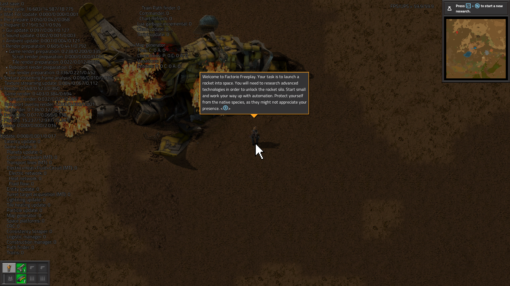
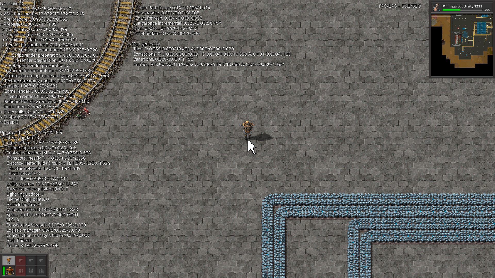

# Factorio launcher for Xbox Developer Mode (unofficial)

Runs **your own copy** of Factorio (Windows x64, 2.0) on an Xbox Series X|S in Developer Mode, as its own
app with controller support.

## Proof of concept

Captured on an **Xbox Series S** (Developer Mode, OS 26100.9647) on 2026-10-27 with Device Portal's
screenshot API, while the launcher ran Factorio 2.0.77 from an unmodified `factorio.exe`. Factorio's own
debug overlay is on (`show-fps` / `show-time-usage`), so the frame and tick timings in the shots are the
game's live measurements.

| Freeplay start, 59.9 FPS / 59.9 UPS | 10k SPM megabase (3.77M entities), 53.0 FPS / 53.0 UPS |
|---|---|
|  |  |

The console's process list (Device Portal `/api/resourcemanager/processes`) while the megabase ran:

```
console: XBOX | OS 26100.9647.amd64fre.xb_flt_2610ge.261021-2200 | edition SystemOS
FactorioXbox.exe  PID 4628  package FactorioXbox_0.1.0.0_x64__2wq9xwan7esye  working set 3.55 GB  running
```

Notes:

- **Native, not streamed or emulated.** The game's x64 code runs on the console's own CPU inside the
  launcher's app process. The xbox-pc-host loader maps the PE image and answers its Windows API calls;
  Direct3D 11 goes to the console's GPU driver.
- **Startup:** about 20 to 30 seconds to the main menu, then the save loads. Both shots were taken by
  starting Factorio with `--load-game <save>` (set in the game folder's `host-args.txt`), with no controller.
- **Freeplay:** a fresh freeplay map runs at the full 60 UPS; one update takes well under 1 ms.
- **Megabase:** the "Modular 10k SPM" community map with trees, rocks, decoratives and unmined ore
  removed so it fits the app's memory (about 3.5 GB in use of the roughly 5 GB a Series S app gets). Game
  updates take 16 to 18 ms, so it runs at 53 to 56 UPS; a Ryzen 5600X PC takes 9.6 ms per tick on the same map.
- **Settings** from [config/console-settings.ini](config/console-settings.ini): medium graphics, low video
  memory, effects like smoke and decoratives off.

## What's in this repository

This repository contains no part of Factorio. It holds:

| Part | What it is |
|---|---|
| `app/` | The UWP app: a project file, manifest and icons. Its code is the [xbox-pc-host](https://github.com/jdial1/xbox-pc-host) loader, compiled from a checkout of that repository. The loader maps the unmodified `factorio.exe` and answers its Windows calls inside the Xbox app sandbox. |
| `scripts/prepare.py` | Builds the console copy of the game from a Factorio you own, in `staging/` (never committed). It copies the exe and data unchanged and adjusts only text files: a self-contained `config-path.cfg`, `config.ini` with the console settings, and two small files that tell the loader what to start. |
| `config/console-settings.ini` | The Factorio settings the console copy gets: controller input, no update check, graphics for the Series S memory budget, an FPS overlay. |
| `scripts/build.ps1` | Builds and signs the app package. |
| `scripts/deploy.py` | Installs the app, uploads the prepared game into the app's storage on the Xbox, and launches it, through Device Portal. |

Factorio's files go from your PC to your Xbox and nowhere else. You need a DRM-free copy: the standalone
zip or installer from factorio.com (Steam's files work too if they're the plain Windows build).

## Requirements

- An Xbox Series X|S in [Developer Mode](https://learn.microsoft.com/windows/uwp/xbox-apps/devkit-activation),
  with Device Portal on (Dev Home > Remote Access).
- Windows 10/11 with Visual Studio 2022 or its Build Tools: "Universal Windows Platform development" and
  "C++ (v143) Universal Windows Platform tools", plus a Windows 11 SDK.
- Python 3.9 or later.
- A checkout of xbox-pc-host next to this one (`..\xbox-pc-host`), or anywhere with `-HostRepo`.
- Factorio 2.0 for Windows x64 (tested with 2.0.77).

## Steps

```
git clone https://github.com/jdial1/xbox-pc-host ..\xbox-pc-host
powershell -ExecutionPolicy Bypass -File scripts\build.ps1
python scripts\prepare.py "C:\Games\Factorio_2.0.77"
python scripts\deploy.py all --console 192.168.1.50
```

`build.ps1` makes a self-signed certificate (`CN=FactorioXbox`) the first time and signs the package with it.
`deploy.py all` installs the package, uploads about 1.5 GB of game files (a few minutes; a rerun resumes),
and starts the app, which starts Factorio. In Dev Home, set the app's type to **Game**
(View button > View details), or it only gets a small share of memory and GPU.

Add saves with `prepare.py ... --saves <folder of .zip saves>` and run `deploy.py upload` again.
`deploy.py logs` fetches the loader's and Factorio's logs into `logs/`; `deploy.py shot` saves a screenshot.

## Playing

- Turn the controller on **before** launching: Factorio only picks up a pad that is connected when it starts.
- In the controller scheme, **Y** confirms dialogs and the D-pad moves between buttons.
- The first start takes about 30 seconds to the main menu.
- A Series S runs a 10k SPM megabase at about 56 UPS; memory (about 5 GB for the app) limits map size.

## Updating

Install updates over the existing app (`deploy.py install`): **uninstalling deletes the app's storage**,
including the uploaded game and your saves. New Factorio version: `prepare.py` again, then `deploy.py upload`.

## Status

Main menu, freeplay and saved games, controller, and audio work. Multiplayer, the mod portal and Steam
features are untested; the loader has no network stack beyond what Factorio needs to start.

See [NOTICE.md](NOTICE.md) for trademarks and licensing.
